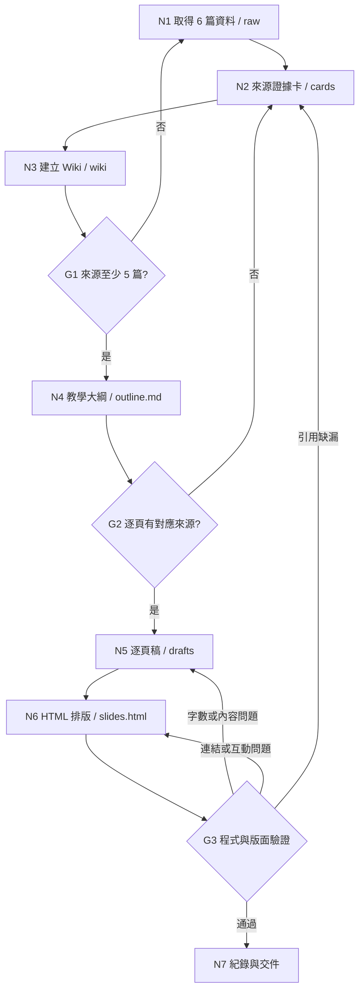

# Graph / Loop 工作流程設計

## 主流程（固定 Graph）

## 每個節點的輸入、輸出和檢查

| 節點 | 輸入 | 輸出 | 檢查 / 退回 |
|---|---|---|---|
| N1 來源整理 | 原始公開網站、論文 | `raw/Sxx.md`、`sources.json` | 至少 5 筆可追溯 URL，否則停止 |
| N2 證據卡 | 單一來源摘記 | `cards/Sxx.md` | 觀點必須被該來源支持，否則回 N1 |
| N3 Wiki | 證據卡 | `wiki/*.md`、`wiki.html` | 內容引用 Sxx；遺失來源回 N2 |
| N4 大綱 | Wiki | `outline.md` | 初學者教學順序與完整覆蓋率 |
| N5 逐頁稿 | 大綱與對應 Wiki | `drafts/slide_script.md` | 每頁至少一個來源；若不支持，回 N2 |
| N6 渲染 HTML | 已通過的逐頁稿 | `slides.html`、JS/CSS | 不改技術論述，只處理版面和互動 |
| N7 驗收 | 上述檔案 | `reports/validation.txt` | 程式 + 瀏覽器測試 + 人工複核 |

## 內部 Loop（最多 3 輪）

每次只修測試報告明列的失敗項目 → 重新執行檢查 → 全部通過即停止。若來源不足或內容互相衝突，不允許用想像補全；改回前段節點尋找證據。

## 人工關卡

- 在 `REQUIREMENTS.md` 確認受眾、語言及簡報範圍。
- 在 `outline.md` 檢視教學順序是否容易理解。
- 在交件前抽查來源卡與 Wiki 每個重點主張；確認案例標示為虛構。
